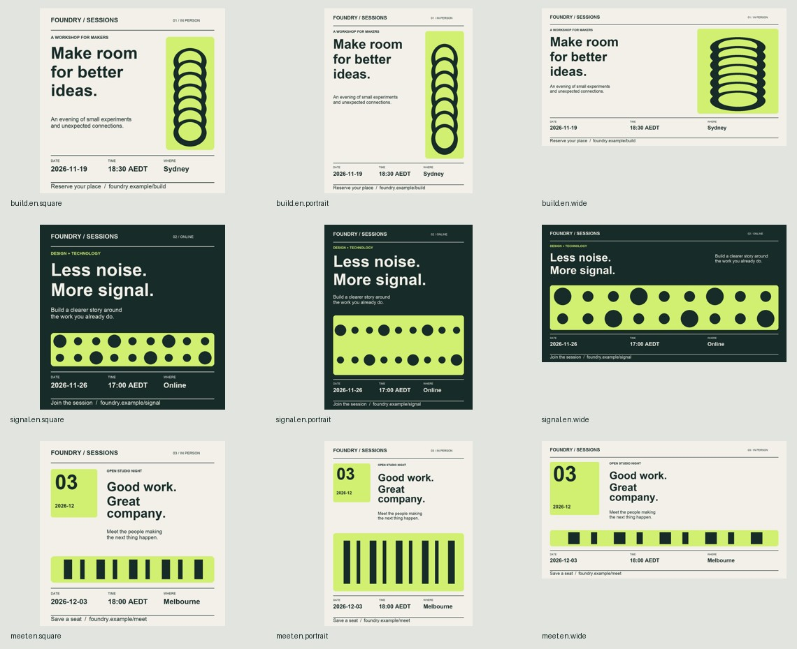

# Campaign Batch

**One event list. A consistent set of campaign graphics.**

For event organizers, community teams and small marketing teams who already have a brand and approved copy. Turn a workshop series into square, portrait and wide graphics without rebuilding each canvas.



**Demo:** three fictional Foundry sessions → nine PNGs, nine editable SVGs, a contact sheet and a per-item report. [See the input and complete output](examples/event-series/README.md).

## Start with the example

```sh
git clone https://github.com/IFFiend/campaign-batch.git
cd campaign-batch
python3 -m venv .venv
.venv/bin/python -m pip install -r requirements.txt
.venv/bin/python scripts/campaign.py examples/event-series/input.json --out output/first-campaign
```

Open `output/first-campaign/index.html`. Inspect the contact sheet before using the individual graphics. Python 3.10+; Windows uses `.venv\Scripts\python.exe`.

## Make your own campaign

Copy [input.json](examples/event-series/input.json). Replace the brand colours, event copy, dates, IANA timezone, venue and registration text. Supply local images and a protected crop region if the subject must remain visible. Fonts and images stay on your machine; there is no builder API key.

| Layout | Best starting point |
| --- | --- |
| Editorial | Title-led workshops with a tall image or motif |
| Signal | A short, strong announcement with a horizontal visual |
| Ticket | Date-led events with a prominent date block |

Working formats: 1080×1080, 1080×1350 and 1920×1080. These are generic ratios, not a promise of current platform acceptance. Titles that cannot fit at the readable floor fail rather than being silently truncated. Approved dates, timezones and registration text are preserved.

Read the [input contract](references/input-contract.md) for custom fonts, photos, supplied translations and capacity limits. No font binaries are bundled. The demo uses Arial on macOS/Windows or DejaVu Sans on Linux. SVG text needs matching fonts; PNG is the delivery reference.

## Use as a skill

The repository root is the skill: [SKILL.md](SKILL.md). Clone the entire folder into your agent's supported skills directory, then install its Python requirements in the environment your agent uses.

```sh
git clone https://github.com/IFFiend/campaign-batch.git ~/.agents/skills/campaign-batch
```

> Use $campaign-batch to make a proof for this workshop series. Keep approved facts unchanged, use our brand, and show one representative graphic before the full batch.

## What is checked

Glyph coverage, measured text fit, text collisions, artwork boundaries, image crop protection, output dimensions and simple solid-background contrast. [Design decisions](references/design-decisions.md) explain when to switch layouts instead of shrinking type.

Technical pass does not establish visual quality or marketing performance. Inspect the final images, especially long titles, photos and language variants. Experimental v0.1; controlled comparisons against strong prompting are not complete.

## Feedback and development

Use the **Use report** issue form to share the actual campaign, missing outputs and manual corrections. Keep client information private. Run checks with `python -m unittest discover -s tests -v`.

## License

[PolyForm Noncommercial 1.0.0](LICENSE).

## 中文

面向活动组织者和小型营销团队：提供品牌资料与活动清单，生成方图、竖图和横图。先运行上方示例，再替换为自己的数据。根目录 SKILL.md 可作为独立 skill 安装；完整输入和九张输出都在示例目录中。使用权限以 LICENSE 为准。
