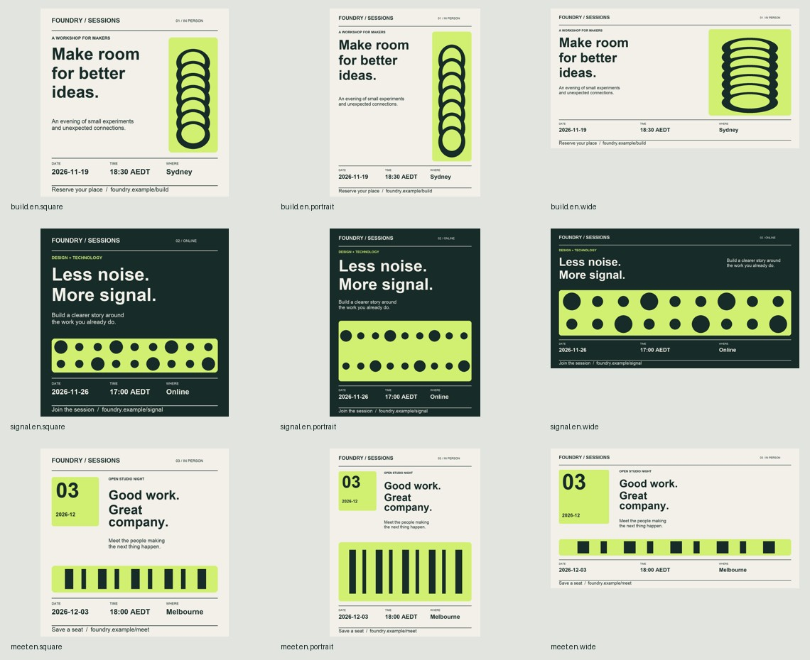

# Three sessions, nine graphics

Audience: an event coordinator preparing a workshop series. [Brief](request.md) · [Input](input.json) · [Complete generated output](output) · [Technical report](output/report.json)



Each event selects one layout. All three aspect ratios are generated, keeping brand colours and locked facts. Output includes PNGs for delivery and SVGs for editing. Run from the repository root:

```sh
python scripts/campaign.py examples/event-series/input.json --out output/my-event-series
```

Examples are fictional. A technical pass does not establish visual quality or platform acceptance. Review actual viewing size before use.
